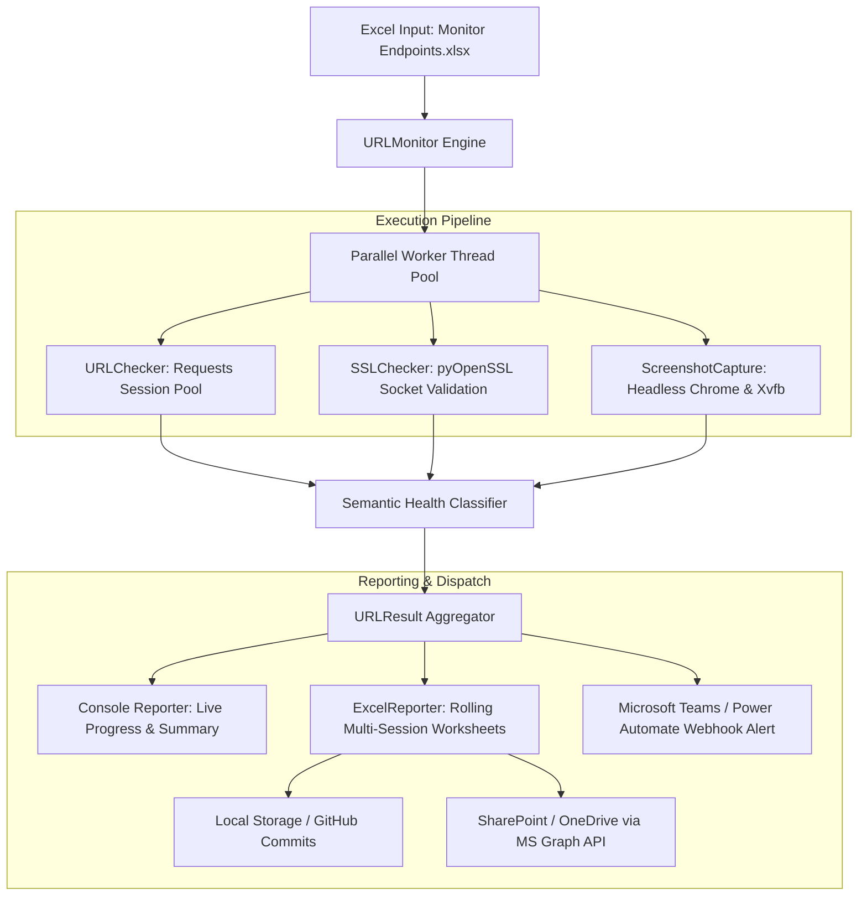

# 🌐 Enterprise Website & API Monitor

[](https://www.python.org/)
[](https://github.com/features/actions)
[](https://www.selenium.dev/)
[](https://openpyxl.readthedocs.io/)
[](https://opensource.org/licenses/MIT)
[](https://github.com/psf/black)

An enterprise-grade, high-throughput website, API, and SSL monitoring engine designed for production environments. Features intelligent HTTP semantics classification, automated headless Chrome screenshot capture, rolling multi-session Excel reporting, Microsoft Graph SharePoint synchronization, and automated incident alerting via Microsoft Teams and GitHub Actions.

---

## 📌 Table of Contents

- [Key Architecture & Data Flow](#-key-architecture--data-flow)
- [Core Features](#-core-features)
- [Health & Classification Matrix](#-health--classification-matrix)
- [Project Structure](#-project-structure)
- [Getting Started](#-getting-started)
  - [Prerequisites](#prerequisites)
  - [Installation & Setup](#installation--setup)
  - [Running Locally](#running-locally)
- [Input Schema (`Monitor Endpoints.xlsx`)](#-input-schema-monitor-endpointsxlsx)
- [Configuration & Environment Variables](#-configuration--environment-variables)
- [Automated Reporting & Screenshot Storage](#-automated-reporting--screenshot-storage)
- [CI/CD & Task Scheduler Automation](#-cicd--task-scheduler-automation)
  - [GitHub Actions Workflow](#github-actions-workflow)
  - [Windows Task Scheduler Integration](#windows-task-scheduler-integration)
- [Testing & Validation](#-testing--validation)
- [Console Output Preview](#-console-output-preview)
- [License](#-license)

---

## 🏗️ Key Architecture & Data Flow



---

## 🚀 Core Features

- **⚡ High-Throughput Concurrent Execution**:
  - Thread-pooled asynchronous execution with configurable worker count (`MAX_WORKERS = 10+`).
  - Thread-local connection pooling with custom retry adapters for resilient HTTP networking.

- **🧠 Semantic Health Classification**:
  - Context-aware validation differentiating between `Frontend` applications and `Backend` / `API` microservices.
  - Recognizes that root `404 Not Found` on APIs indicates an active router rather than service outage.
  - Understands access-restricted (`401 Unauthorized`, `403 Forbidden`) endpoints as operational and reachable.
  - Supports strict status code contracts via `Expected Status Codes` (e.g., `200, 204` or `401`).

- **📸 Automated Headless Chrome Visual Capture**:
  - Integrated Selenium WebDriver manager with automatic Chrome/ChromeDriver version matching.
  - Headless rendering with Linux `Xvfb` virtual frame buffer support for seamless CI/CD container execution.
  - Advanced challenge detection: verifies CDN/browser verification screens (Cloudflare) and captures native Basic Authentication dialogs.

- **🔒 Real-Time SSL Certificate Lifecycle Monitoring**:
  - Direct TLS handshake inspection via `pyOpenSSL` socket probe.
  - Calculates expiration date, remaining validity days, and issues automated alerts for certificates expiring in `< 7 days` (critical) or `< 30 days` (warning).

- **📊 Rolling Multi-Session Excel Reporting**:
  - Generates polished, executive-ready Excel reports formatted with custom typography, status badges, and color-coded rows.
  - Daily sheets (`YYYY-MM-DD`) organized by Morning and Afternoon inspection runs. Re-running a session gracefully updates that session without corrupting prior data.

- **☁️ Cloud & ChatOps Integrations**:
  - **Microsoft Teams & Power Automate**: Rich MessageCard payloads with run metadata, on-call assignments, and live report links.
  - **Microsoft Graph API**: Direct cloud synchronization with SharePoint / OneDrive workbooks and screenshot attachments.

---

## 🩺 Health & Classification Matrix

The engine avoids naive "200 = good, anything else = bad" assumptions by applying real-world endpoint semantics:

| HTTP Status / Condition | Endpoint Type | Evaluation | Detailed Behavior |
|:---|:---|:---:|:---|
| **2xx (200, 201, 204)** | Any | 🟢 **SUCCESS** | Target is responsive and healthy. |
| **3xx (301, 302, 307, 308)** | Any | 🟢 **SUCCESS** | Redirect resolved correctly. |
| **401 Unauthorized** | Any | 🟢 **SUCCESS** | Service is running; access requires authentication. Basic Auth dialog captured in screenshot. |
| **403 Forbidden** | Backend / API | 🟢 **SUCCESS** | Service is running; security / rate-limit layer active. |
| **403 Forbidden** | Frontend | 🔍 **VERIFY** | Verified via Chrome. If a CDN challenge passes, reported as **SUCCESS**. If blocked, reported as **FAILED**. |
| **404 Not Found** (at `/`) | Backend / API | 🟢 **SUCCESS** | API host is active; root path does not serve resources. |
| **404 Not Found** | Frontend | 🔴 **FAILED** | Missing page or dead link. |
| **408, 429, 500, 502, 503, 504** | Any | 🔄 **RETRY** | Automatically retried up to `MAX_RETRIES`. Fails only if all retries exhaust. |
| **Expected Status Codes** | Configured | 🎯 **EXACT** | Overrides standard rules. Only matching status codes pass (e.g., `401` or `200, 204`). |

---

## 📂 Project Structure

```text
Monitor-App/
├── .github/
│   └── workflows/
│       └── website-monitor.yml       # Production GitHub Actions CI/CD workflow
├── .env.example                      # Configuration template with all supported variables
├── .gitignore                        # Git exclusion rules for secrets, caches, and reports
├── Monitor Endpoints.xlsx            # Input workbook defining target URLs & contracts
├── README.md                         # Comprehensive project documentation
├── requirements.txt                  # Python production dependencies
├── setup_task_scheduler.ps1          # Windows Task Scheduler automation setup
├── test_website_monitor.py           # Unit test suite covering classification & reporting
├── trigger_workflow.ps1              # Remote GitHub Actions dispatch script
└── website_monitor.py                # Core multi-threaded monitoring application
```

---

## 🛠️ Getting Started

### Prerequisites

- **Python**: `3.10` or higher
- **Google Chrome**: Installed on the system (required for visual screenshot capture; runs in `--headless` mode).

### Installation & Setup

1. **Clone the repository:**
   ```bash
   git clone https://github.com/YOUR_USERNAME/Monitor-App.git
   cd Monitor-App
   ```

2. **Create and activate a virtual environment:**
   ```bash
   # On macOS/Linux:
   python3 -m venv .venv
   source .venv/bin/activate

   # On Windows (PowerShell):
   python -m venv .venv
   .venv\Scripts\Activate.ps1
   ```

3. **Install dependencies:**
   ```bash
   pip install --upgrade pip
   pip install -r requirements.txt
   ```

4. **Prepare environment configuration (Optional):**
   ```bash
   cp .env.example .env
   ```

### Running Locally

Execute the monitor with default settings:
```bash
python website_monitor.py
```

To run without launching browser screenshots (fast lightweight mode):
```bash
# Linux/macOS
MONITOR_WITH_SCREENSHOT=0 python website_monitor.py

# Windows (PowerShell)
$env:MONITOR_WITH_SCREENSHOT="0"; python website_monitor.py
```

---

## 📑 Input Schema (`Monitor Endpoints.xlsx`)

The application ingests target endpoints from `Monitor Endpoints.xlsx`. The table below outlines the schema:

| Column Header | Type | Required | Description | Example |
|:---|:---:|:---:|:---|:---|
| `Group ID` | Integer / String | Optional | Organizational ID for grouping services | `1`, `Core-APIs` |
| `Host` | String | Optional | Friendly label or hostname | `api.github.com` |
| `Type` | String | Optional | Target classification (`frontend`, `Backend`, `API`) | `Backend` |
| `Target URL` | String | **Required** | The full HTTP/HTTPS URL to check | `https://api.github.com` |
| `Expected Status Codes` | String | Optional | Comma-separated accepted HTTP status codes | `200, 204` or `401` |

### Sample Configuration:

| Group ID | Host | Type | Target URL | Expected Status Codes |
|:---:|:---|:---|:---|:---:|
| 1 | Google Search | frontend | `https://www.google.com` | |
| 1 | GitHub Web | frontend | `https://github.com` | |
| 2 | GitHub REST API | Backend | `https://api.github.com` | 200 |
| 2 | JSONPlaceholder | Backend | `https://jsonplaceholder.typicode.com/posts` | 200 |
| 3 | Protected Gateway | frontend | `https://httpbin.org/status/401` | 401 |
| 3 | Microservice Health | Backend | `https://httpbin.org/status/204` | 200, 204 |

---

## ⚙️ Configuration & Environment Variables

All settings can be overridden via environment variables or a `.env` file:

| Variable | Default | Description |
|:---|:---:|:---|
| `MONITOR_INPUT_FILE` | `Monitor Endpoints.xlsx` | Path to the input Excel spreadsheet. |
| `MONITOR_REPORT_FILE` | `reports/Website_Monitor_Report.xlsx` | Output destination for generated Excel reports. |
| `MONITOR_MAX_WORKERS` | `10` | Concurrency thread pool limit. |
| `MONITOR_TIMEOUT` | `20` | HTTP request timeout in seconds. |
| `MONITOR_MAX_RETRIES` | `4` | Retry attempts for transient errors (500, 502, 503, 504, 429). |
| `MONITOR_RETRY_DELAY` | `2.0` | Initial backoff delay between retries in seconds. |
| `MONITOR_WITH_SCREENSHOT` | `1` | Enable (`1`) or disable (`0`) Chrome screenshot capture. |
| `MONITOR_AUTH_BROWSER_UI_SCREENSHOT`| `1` | Enable headed browser capture for HTTP 401 Basic Auth dialogs. |
| `SCREENSHOT_UPLOAD_PROVIDER` | `tmpfiles` | Provider for uploading screenshots (`tmpfiles` or custom URL). |
| `TEAMS_WEBHOOK_URL` | *None* | Incoming webhook URL for Microsoft Teams / Power Automate. |
| `SHAREPOINT_TENANT_ID` | *None* | Azure Active Directory Tenant ID for SharePoint sync. |
| `SHAREPOINT_CLIENT_ID` | *None* | Azure App Registration Client ID. |
| `SHAREPOINT_CLIENT_SECRET` | *None* | Azure App Registration Client Secret. |
| `SHAREPOINT_WORKBOOK_URL` | *None* | Web URL or sharing link of the target cloud Excel workbook. |

---

## 📈 Automated Reporting & Screenshot Storage

1. **Daily Rolling Worksheets**:
   - Each run appends to a dated worksheet (e.g., `2026-09-29`).
   - Morning (<12:00 PM) and Afternoon (>=12:00 PM) sessions are categorized separately.
   - Idempotent: Re-executing a session updates the existing section in-place without duplicating rows.

2. **Visual Screenshot Delivery**:
   - In automated CI/CD workflows, screenshots are uploaded and formatted as direct hyperlinks inside the Excel report cells.
   - Viewers can click directly on the cell to inspect the actual visual state of the site during the run.

---

## 🤖 CI/CD & Task Scheduler Automation

### GitHub Actions Workflow

The repository includes a production-ready workflow in `.github/workflows/website-monitor.yml`:
- **Triggers**: Manual dispatch or daily scheduled cron runs (e.g. 10:00 AM and 4:30 PM).
- **Environment**: Installs Python 3.11, Google Chrome stable, and `Xvfb` for headless graphic rendering.
- **Persistence**: Automatically commits and pushes updated reports back to the repository.
- **ChatOps**: Dispatches formatted status cards to Microsoft Teams with live report links and on-call assignments.

#### Required GitHub Secrets:
To enable notifications and cloud sync, configure these in **Settings > Secrets and variables > Actions**:
- `TEAMS_WEBHOOK_URL`: Your Microsoft Teams incoming webhook or Power Automate endpoint.
- `SHAREPOINT_TENANT_ID`, `SHAREPOINT_CLIENT_ID`, `SHAREPOINT_CLIENT_SECRET`: (Optional) Microsoft Graph credentials for cloud workbook synchronization.

### Windows Task Scheduler Integration

To trigger the monitoring pipeline from a local Windows workstation:

1. **Configure your GitHub Personal Access Token**:
   ```powershell
   setx MONITOR_GITHUB_PAT "ghp_yourPersonalAccessTokenHere"
   setx MONITOR_GITHUB_REPO "YOUR_USERNAME/Monitor-App"
   ```
2. **Register the Task (Run as Administrator)**:
   ```powershell
   .\setup_task_scheduler.ps1
   ```
   *Registers two daily automated triggers at 10:00 AM and 4:30 PM.*

3. **Trigger manually anytime**:
   ```powershell
   .	rigger_workflow.ps1
   ```

---

## 🧪 Testing & Validation

The codebase includes an extensive unit test suite covering response classification, SSL validation, retry policies, and Excel generation.

Run tests using `pytest`:
```bash
pytest test_website_monitor.py -v
```

Output:
```text
============================= test session starts =============================
test_website_monitor.py::URLCheckerClassificationTests::test_normal_http_success PASSED
test_website_monitor.py::URLCheckerClassificationTests::test_authentication_and_protection PASSED
test_website_monitor.py::URLCheckerClassificationTests::test_backend_root_404_is_reachable PASSED
test_website_monitor.py::URLCheckerClassificationTests::test_expected_codes_enforce_contract PASSED
...
============================= 31 passed in 1.57s ==============================
```

---

## 🖥️ Console Output Preview

```text
==========================================================================================
STARTING URL MONITOR - Found 1 sheets
==========================================================================================

--- Sheet: URL Monitor Report (12 URLs) ---
[  1/12] [OK] SUCCESS  | https://www.google.com
[  2/12] [OK] SUCCESS  | https://github.com
[  3/12] [OK] SUCCESS  | https://www.python.org
[  4/12] [OK] SUCCESS  | https://developer.mozilla.org
[  5/12] [OK] SUCCESS  | https://www.cloudflare.com
[  6/12] [OK] SUCCESS  | https://api.github.com
[  7/12] [OK] SUCCESS  | https://jsonplaceholder.typicode.com/posts
[  8/12] [OK] SUCCESS  | https://httpbin.org/get
[  9/12] [OK] SUCCESS  | https://reqres.in/api/users
[ 10/12] [OK] SUCCESS  | https://httpbin.org/status/401
[ 11/12] [OK] SUCCESS  | https://httpbin.org/status/403
[ 12/12] [OK] SUCCESS  | https://httpbin.org/status/204

==========================================================================================
SUCCESS: 12/12 (100.0%)
FAILED:  0/12 (0.0%)
Avg Response Time: 420.5 ms
Completed in 4.82s (2.5 URLs/sec)
==========================================================================================
💾 Report saved: reports/Website_Monitor_Report.xlsx
```

---

## 📄 License

This project is licensed under the [MIT License](LICENSE).
